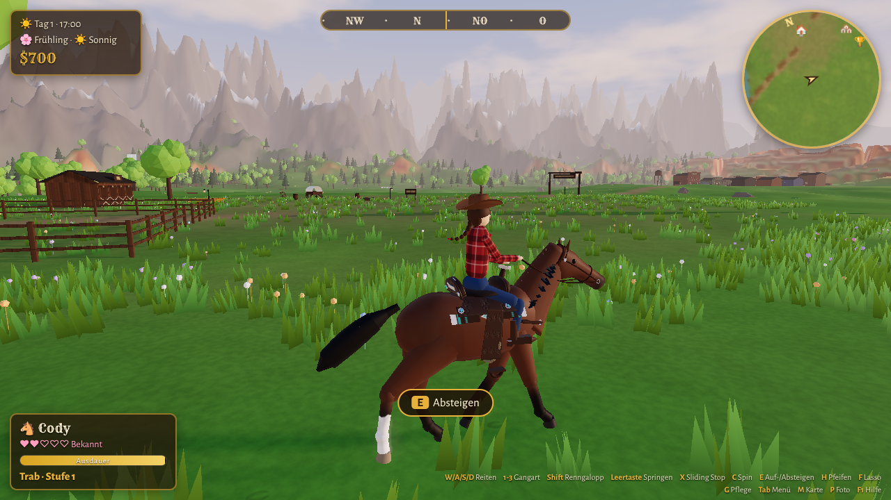
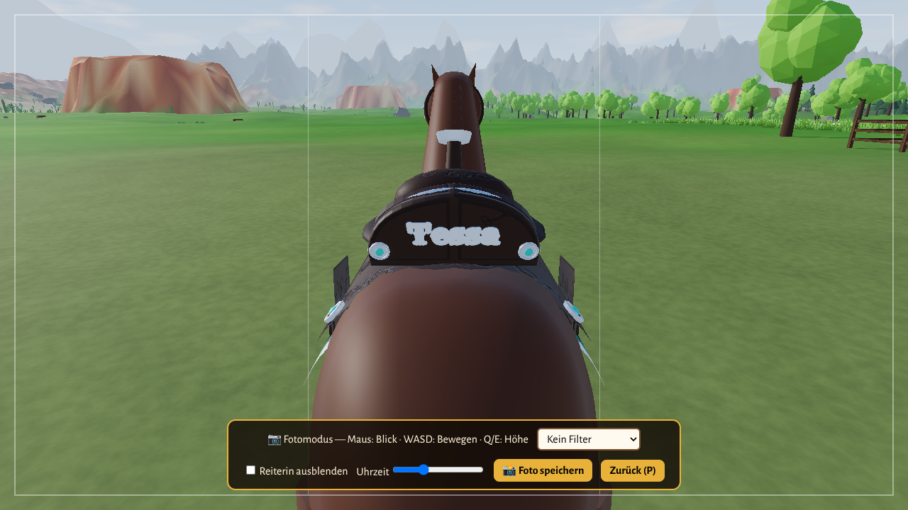
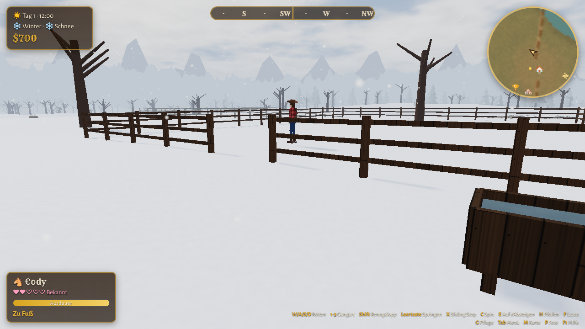
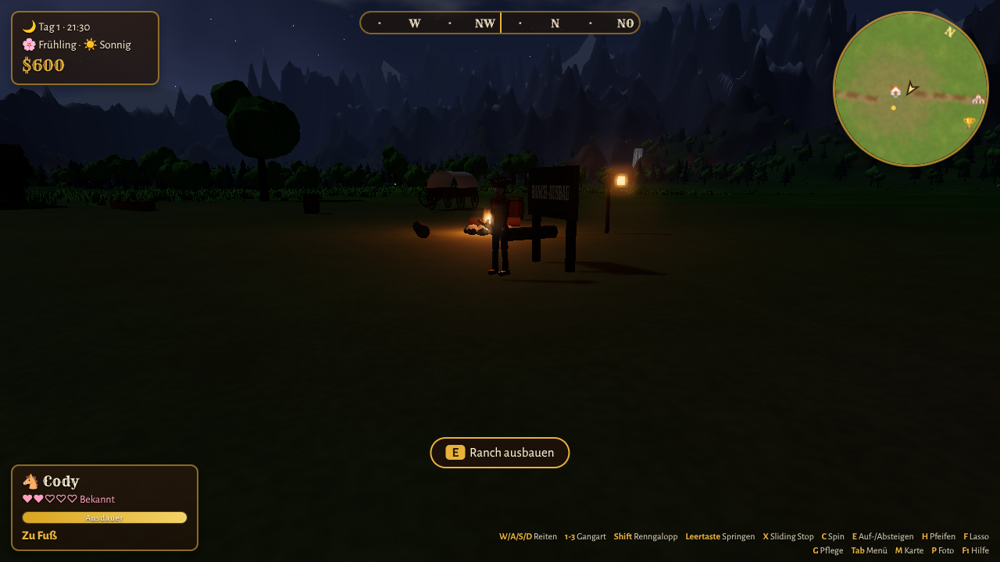

# 🐎 Silver Spur Ranch – Western-Reitspiel in 3D

Ein 3D-Pferdespiel im Wilden Westen, das komplett im Browser läuft (Three.js / WebGL).
Du spielst eine Reiterin auf deiner eigenen Ranch, reitest frei durch eine große offene Welt,
baust die Ranch aus, sammelst Pferde aller Rassen, pflegst sie und trittst bei Rodeos an.

Alle Grafiken, die Countrymusik und die Geräusche entstehen live im Browser. Es gibt keine
Bild- oder Sounddateien und auch keinen Build-Schritt.

| | |
|---|---|
|  |  |
|  |  |

## Starten

```bash
npm start            # startet einen kleinen Webserver auf http://localhost:8080
```

Alternativ geht jeder andere statische Webserver, zum Beispiel `python3 -m http.server`.
Die Seite muss über `http://` geöffnet werden, weil ES-Module per Doppelklick (`file://`) nicht laden.
Über *GitHub Pages* (Branch-Root) lässt sich das Spiel direkt online spielen.

Unterstützt werden aktuelle Desktop-Browser (Chrome, Edge, Firefox, Safari) mit Tastatur und Maus.
Die Grafikqualität (Niedrig/Mittel/Hoch) wird im Startmenü gewählt.

## Auf dem Handy (Web-App)

Das Spiel ist eine installierbare Web-App (PWA). Es läuft nach dem ersten Laden auch offline.

1. Spiel über **https** aufrufen, zum Beispiel per GitHub Pages.
2. **Android (Chrome):** im Startmenü auf „📲 Als App installieren“ tippen.
   **iPhone (Safari):** auf *Teilen* tippen, dann *Zum Home-Bildschirm*.
3. Das Handy quer halten. Die App startet im Vollbild.

Touch-Steuerung:
- **Joystick links:** reiten oder laufen. Je weiter du drückst, desto schneller wird die Gangart.
- **Rechts wischen:** Kamera drehen. Mit zwei Fingern zoomen.
- **Knöpfe rechts:** Springen, Sprint, Stopp (Sliding Stop), Spin, Lasso, Loben. Zu Fuß: Pfeifen, Pflege, Ducken.
- Ein **goldener Kontext-Knopf** erscheint, sobald du aufsteigen, sprechen oder etwas benutzen kannst.
- **Oben:** Menü, Karte, Aufträge, Foto, Pause.

Auf Touch-Geräten wählt das Spiel automatisch die Grafikstufe „Handy“. Dabei laufen mittelfeine Pferdemodelle, die Pixeldichte ist reduziert und die Kantenglättung kommt direkt von der Grafikkarte.

Nach Änderungen an Dateien `npm run build:sw` ausführen, damit installierte Apps die neue Version laden.
Die Pferdemodelle werden mit `node tools/build-horses.mjs` neu berechnet.

## Steuerung

| Taste | Reiten | Zu Fuß |
|---|---|---|
| W / S | vorwärts / bremsen, im Stand rückwärtsrichten | laufen |
| A / D | lenken | seitwärts |
| 1 · 2 · 3 (oder Q / R) | Schritt · Trab · Galopp | – |
| Shift (halten) | eine Gangart schneller → Renngalopp | rennen |
| Leertaste | springen (ab Trab) | – |
| X | Sliding Stop (aus dem Galopp) | – |
| C (+ A/D) halten | Spin im Stand | ducken (Wildpferde zähmen) |
| Z / Y | Steigen (ab Bindung „Vertraut“) | – |
| T | Pferd loben | – |
| F | Lasso werfen / loslassen | Lasso |
| E | absteigen / benutzen | aufsteigen, sprechen, benutzen |
| H | – | Pferd herpfeifen |
| G | – | Pferd pflegen |
| Maus ziehen / Klick | Kamera drehen (Klick fängt die Maus) | |
| Mausrad | Zoom | |
| Tab / I · M · J · B · P | Menü · Karte · Aufträge · Ranch ausbauen · Fotomodus | |
| Esc / F1 | Pause / Hilfe | |

## Was es alles gibt

- **Welt:** Prärie, rote Canyons und Tafelberge, Wälder, schneebedeckte Berge, ein Fluss zum Durchreiten und ein Wasserfall. Dazu das Städtchen *Dusty Creek* und die Rodeo-Arena.
- **Atmosphäre:** Tag- und Nachtwechsel mit Sonnenuntergängen, Sternenhimmel, Mond und Lagerfeuer. Als Wetter gibt es Sonne, Wolken, Regen, Gewitter mit Blitzen, Morgennebel, Staubstürme und Schnee. Die vier Jahreszeiten bringen Blumenwiesen, buntes Laub und Schnee. Glühwürmchen und fallende Blätter gibt es auch.
- **Pferde:** 21 Rassen, darunter Quarter Horse, Paint, Appaloosa, Mustang, Araber, Friese, Andalusier, Lusitano, Haflinger, Tinker, Isländer, Fjordpferd, Knabstrupper, Akhal-Teke, Vollblut, Trakehner, Hannoveraner, Morgan, Shire, Noriker und Shetty. Jede Rasse hat ihren eigenen Körperbau und eigene Werte für Tempo, Ausdauer und Wendigkeit.
- **Fellfarben:** Rappe, Schimmel (mit Apfelung), Fuchs, Brauner, Palomino, Falbe (mit Aalstrich), Schecke, Tigerschecke, Blanket-Appaloosa und Isabell. Dazu kommen Abzeichen wie Blesse und weiße Socken.
- **Mähne und Schweif** wehen im Wind und beim Galopp. Fesselbehang gibt es bei Friese, Tinker und Shire.
- **Reiten:** Schritt, Trab, Galopp und Renngalopp mit Ausdauerleiste. Du kannst über Baumstämme und Zäune springen und Sliding Stop, Spin und Rückwärtsrichten reiten. Im Sand und Schnee bleiben Hufspuren, im Wasser spritzt es, und je nach Untergrund klingen die Hufschläge anders.
- **Spezialsattel „Tessa“:** dunkelbraunes Leder mit Blumen-Punzierungen, Silber-Conchos, Türkissteinen und dem silbernen Schriftzug „Tessa“ hinten am Sattel. Dazu gehören ein Zaumzeug mit graviertem Namensschild sowie eine passende Satteldecke und ein passendes Brustgeschirr.
- **Ausrüstung:** Sättel, Satteldecken, Zaumzeug, Brustgeschirre, Gamaschen, Fliegenmasken und Mähnenschleifen. Die Mähne lässt sich flechten, auch mit Schleifen, und der Schweif ebenfalls.
- **Reiterin:** Cowboyhüte, Hemden, Westen mit Fransen, Chaps, Stiefel mit Sporen und Halstücher.
- **Ranch:** Du startest mit Stall, Koppel, Planwagen und Lagerfeuer. Ausbauen kannst du Ranchhaus mit Veranda, Schaukelstuhl und Pokal-Vitrine, Scheune, Reitplatz, Round Pen, Wassertränke mit Windrad, Heulager, Weide, zweiten Stall, Hühnerstall, Hundehütte und Rinderweide. Deko wie Laternen, Blumen, Zäune und Sprünge stellst du frei auf.
- **Tiere:** Rinder, Hühner, Ranch-Hund Buddy, der dich begleitet, und eine Stallkatze.
- **Pflege und Bindung:** Bürsten als Minispiel, Hufe auskratzen, Füttern (Heu, Äpfel, Karotten, Leckerlis) und Tränken. Fünf Bindungsstufen bestimmen Gehorsam und Sprungbereitschaft. Pferde haben eine Persönlichkeit (mutig, verspielt, ängstlich oder verschmust) und kommen auf Pfiff.
- **Pferde bekommen:** Pferdehandel in der Stadt mit täglich neuen Pferden, wilde Mustangs zähmen (Minispiel) und Fohlen züchten.
- **Rodeo:** Barrel Racing, Pole Bending, Reining und Trail in drei Klassen. Es gibt Preisgeld, Pokale und Schleifen für die Vitrine.
- **Aufträge** vom Auftragsbrett: Lieferungen, Rinder mit dem Lasso zurücktreiben, das verlorene Kalb suchen, Kurierritte, Zeitritte, Blumen sammeln und Fotoaufträge.
- **Erkunden:** Schatzkarten aus dem Saloon, vergrabene Schätze und 10 versteckte Orte, zum Beispiel Goldmine, Geisterstadt, Steinbogen, heiße Quelle und Bergsee.
- **Extras:** Fotomodus mit Filtern und PNG-Download, 42 Errungenschaften und automatisches Speichern im Browser.

## Technik

- `src/world/`: Terrain mit Höhenfunktion, Himmel-Shader, Wasser, Wetter, Vegetation, Gebäude, Stadt und Orte
- `src/horse/`: Rassen, Anatomie (Skelett und Formen), Pferdemodell mit Fell-Shader, Animation und Physik sowie die Ausrüstung
- `tools/build-horses.mjs`: formt die Pferde aus einem Distanzfeld mit über 60 anatomischen Formen (Muskeln, Gelenke, Kopf). Daraus entstehen glatte Skinned Meshes mit eingebackener Umgebungsverdeckung in drei Detailstufen (`assets/horses/`).
- `sw.js`, `manifest.webmanifest`, `icons/`: Web-App für Handys (offline, Vollbild, Querformat)
- `src/player/`: Reiterin, Steuerung und Kamera
- `src/game/`: Spielstand, Shop-Katalog, Aufträge, Rodeo, Lasso, Pflege, Wildpferde und Zucht, Errungenschaften, Fotomodus
- `src/audio/`: WebAudio-Synthese mit Karplus-Strong-Gitarre, Mundharmonika und Geräuschen
- `vendor/three/`: Three.js r180 (MIT-Lizenz)
